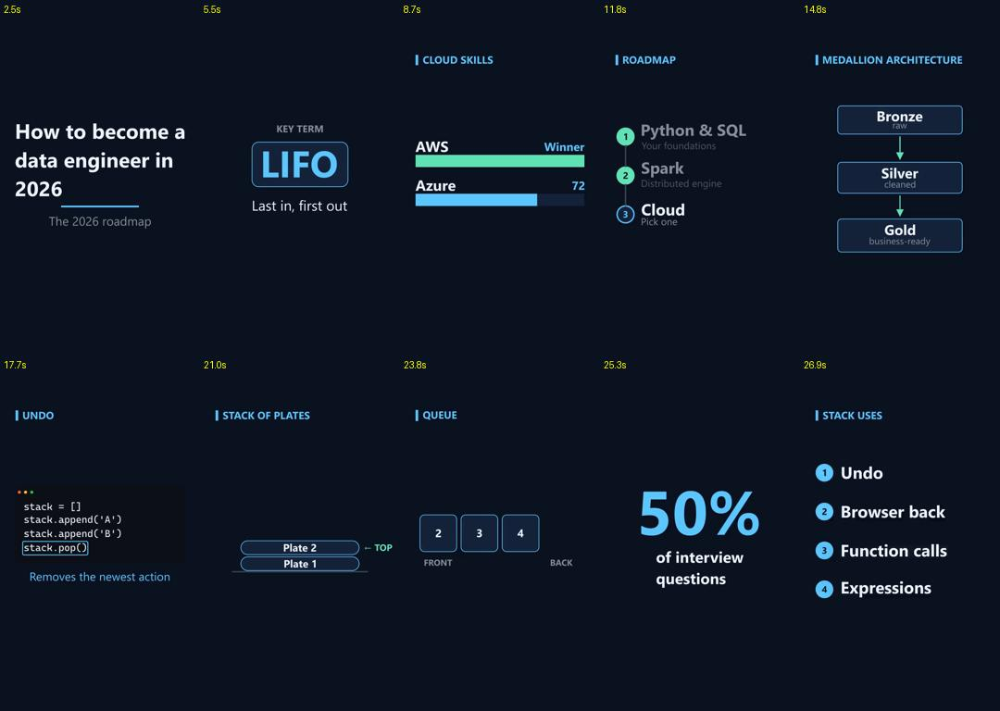

# Framecraft

**Turn a narrated video into synchronized, code-generated educational animation.**

Upload a talking-head or voice-over video. Framecraft transcribes it with word-level timing, plans one visual "beat" per idea, and renders animated B-roll with [Manim](https://www.manim.community/). Each visual appears on the word that introduces it. Everything on screen is drawn from code, with no image or video generation.



## Features

- **Accurate, word-timed transcripts.** `gpt-transcribe` produces the text and `whisper-1` provides word timestamps. The two are aligned word by word, so a corrected term like "LIFO" keeps the timing of what was actually heard. A proofreading pass fixes misheard technical terms and lists the key terms viewers should see.
- **Transcript review.** Edit any line and the key-term list before planning. Edited words keep their original timing.
- **Word-synced lesson beats.** The planner splits the narration into one-idea beats and names the spoken word that triggers each visual. The code converts that word into its exact timestamp, so the AI never guesses times.
- **Nine teaching layouts:** title, key term, list, comparison bars, roadmap, diagram, code snippet, stack/plates/queue analogy, and stat counter.
- **Coverage check.** Spoken key terms that never appear on screen trigger an automatic revision, and any that remain are flagged in the storyboard.
- **Optional procedural 3D.** The *Force 3D* option renders with Three.js and custom GLSL in headless Chrome. The water-cycle scene uses this engine automatically.
- **Works offline too.** Without an API key it falls back to local Faster-Whisper transcription and a built-in rule-based planner.
- **Exports:** MP4 with the original narration, silent MP4, Manim source or code-only 3D source ZIP, SRT transcript, and the scene plan as JSON.

## How it works

```
video ─► transcript (text model + timing model, aligned) ─► review & edit
      ─► lesson plan (beats → layouts → items anchored to spoken words)
      ─► coverage check ─► Manim render (or Three.js) ─► mux original audio ─► MP4
```

| Module | Role |
| --- | --- |
| `backend/transcript.py` | OpenAI transcription, word alignment, sentence grouping, proofreading |
| `backend/lesson.py` | Beat planner prompt, word-index → time resolution, key-term coverage |
| `backend/lesson_renderer.py` | Manim scene that draws the nine layouts on the word timeline |
| `backend/app.py` | FastAPI service, SQLite project store, single-worker job queue |
| `backend/planner.py`, `renderer.py`, `nature.py` | Built-in planner and the original template renderer |
| `backend/cinematic.py`, `cinema/` | Optional Three.js procedural 3D renderer |
| `dist/` | Static web UI (no build step) |

## Requirements

- Python 3.12+
- [Manim Community](https://docs.manim.community/en/stable/installation.html) 0.19+ (in the same environment, or a separate one set with `MANIM_PYTHON`)
- Optional: an OpenAI API key, for accurate transcription and AI planning
- Optional, for Force 3D only: Node.js 22.12+ and Chrome or Edge

## Quick start

```bash
git clone <your-repo-url> framecraft
cd framecraft
cp .env.example .env        # then add OPENAI_API_KEY (optional)
```

Windows (PowerShell):

```powershell
.\start.ps1
```

macOS / Linux:

```bash
chmod +x start.sh && ./start.sh
```

On first run, the start script creates `.venv`, installs `requirements.txt`, and builds the 3D renderer if Node.js is available. Then open <http://127.0.0.1:8765>.

Install Manim into the environment that renders, for example `.venv/Scripts/python -m pip install manim` on Windows or `.venv/bin/python -m pip install manim` elsewhere. If Manim is already installed somewhere else, set `MANIM_PYTHON` instead.

## Using the studio

1. **Upload** a narrated video (up to 200 MB and 3 minutes). Choose the canvas (9:16 or 16:9), quality (540p preview or 1080p), and planner.
2. **Review the transcript.** Fix any misheard word, adjust the key terms, then click **Approve transcript & plan**.
3. **Review the storyboard.** Each beat lists its layout and synced items, and a banner reports key-term coverage. Advanced edits are available in **Edit plan** (validated JSON).
4. **Render**, then download the MP4 with narration.

Existing projects can be **retranscribed**, **replanned**, or **replanned in 3D** at any time.

## Configuration

All settings are optional environment variables, and they can be placed in `.env`:

| Variable | Default | Purpose |
| --- | --- | --- |
| `OPENAI_API_KEY` | – | Enables OpenAI transcription and planning. It can also be entered in Settings, where it is kept in memory only. |
| `OPENAI_MODEL` | `gpt-5.5` | Planning model |
| `FRAMECRAFT_PYTHON` | `.venv` | Python used by the start scripts |
| `MANIM_PYTHON` | current Python | Python with Manim installed |
| `FRAMECRAFT_NODE` | `node` on PATH | Node.js 22.12+ for 3D rendering |
| `FRAMECRAFT_BROWSER` | auto-detected | Chrome/Edge executable for 3D rendering |
| `FRAMECRAFT_DATA` | `./data` | Projects, renders and caches |
| `FRAMECRAFT_PORT` | `8765` | Local port |
| `WHISPER_MODEL` / `WHISPER_CACHE` | `small` / `./.whisper-models` | Local transcription fallback |

The service binds to `127.0.0.1` only, rejects cross-origin mutations, never returns the API key, and never executes AI-generated code. Plans are validated data that a trusted renderer interprets.

## Development

```bash
python -m pip install -r requirements-dev.txt
npm ci && npm run build:cinema     # only needed for the 3D tests/renderer
python -m pytest tests -q
npm run test:cinema
```

`scripts/publish_cinema_demo.py` refreshes the bundled 3D example in `dist/assets` from a locally rendered `cinema-demo` project.

## Limitations

- Plan quality depends on the planning model. Review the storyboard before rendering, especially for ambiguous transcript lines.
- The 3D renderer produces stylized procedural scenes. It is not a physics simulator or a detailed model generator.
- This is a single-user local tool. A hosted multi-user deployment would need authentication, isolated storage and dedicated render workers.
